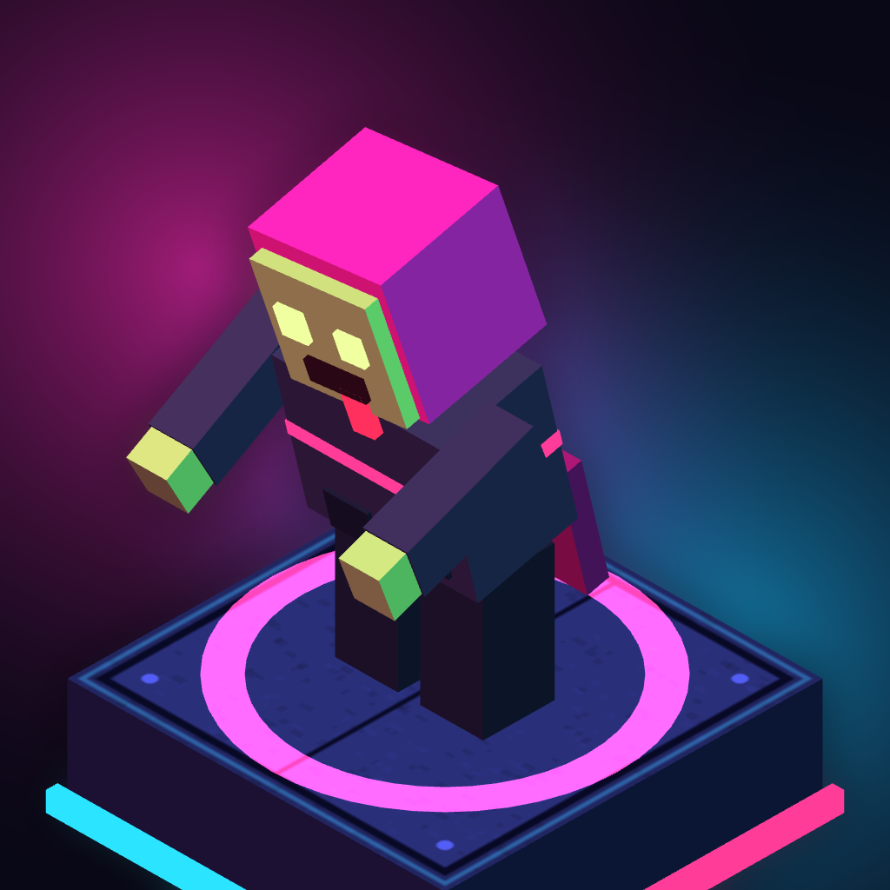
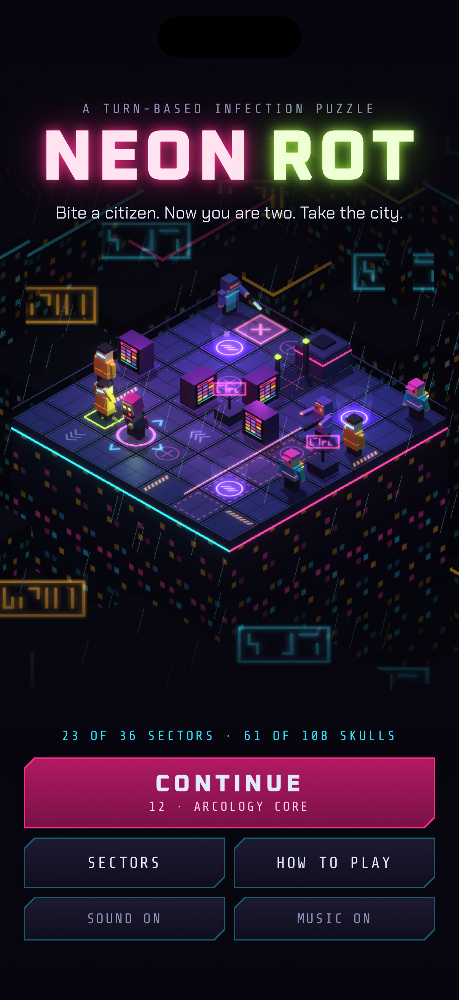
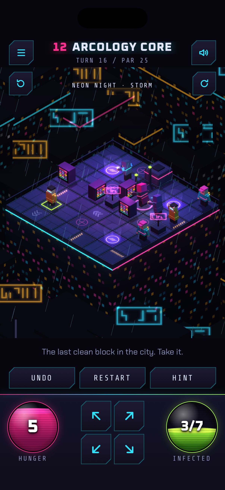
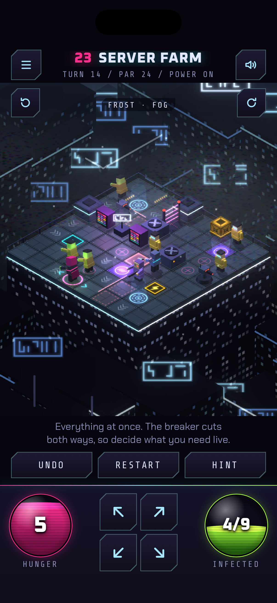
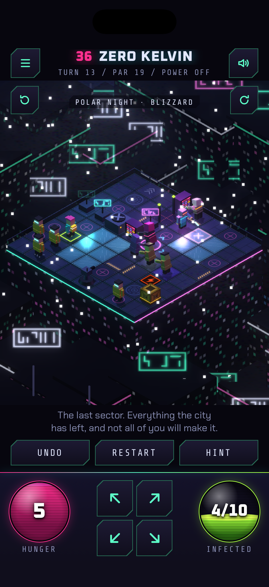
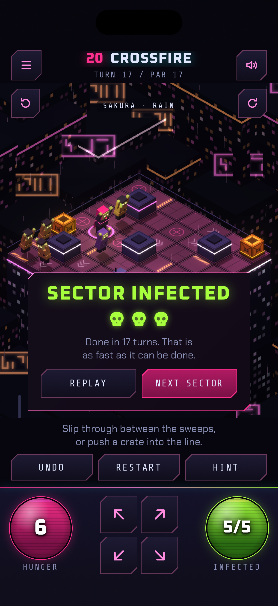
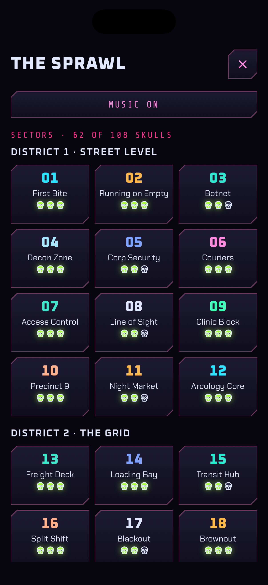

# Neon Rot: press kit

**A turn-based zombie puzzle where you are the zombie, and everyone you bite copies your
every step.**

Out now on iPhone: https://apps.apple.com/us/app/neon-rot/id6833462784

## Fact sheet

| | |
| --- | --- |
| Game | Neon Rot |
| Developer | AMAYARA STUDIO, an indie game studio. Neon Rot is its first game |
| Released | 12 November 2026 |
| Platform | iPhone, iOS 16 or later, portrait |
| Genre | Puzzle, turn-based strategy |
| Price | Free to download. District 1 (12 sectors) is free with no time limit; one purchase of US$2.99 unlocks Districts 2 and 3 (24 more sectors) for good |
| Ads, accounts, data | No ads, no subscription, no account, and the game collects no data |
| Connection | Plays offline. Only buying or restoring the unlock needs a connection |
| Age rating | 13+ |
| Language | English |
| Contact | contact@amayara.com |

## The game

You are patient zero in a neon megacity. Each sector is a small rooftop seen from above at an
angle. Take one step and the turn passes. Walk into a citizen to bite them. They rise, and
from then on they copy every step you take: one becomes two, two become a horde, and the
horde only moves the way you move. A careless step walks all of them into a UV pad or a
sniper's line.

Every step costs hunger and every bite fills it back up. Clear the rooftop before the hunger
runs out.

## What is in it

- 36 sectors in 3 districts, each with its own colours and weather
- Couriers who run, enforcers and patrols who strike, snipers and turrets that fire down
  their line
- UV pads, laser gates and pressure pads, crates to push, transit pads, a breaker that flips
  the power for the whole roof, and ice that will not let you stop
- Puzzles where the answer is to send one of your own into the line of fire so the rest get
  through
- Every sector is solved by a program before it ships, so each one can be won and the par
  shown in the game is the true shortest solution
- Unlimited undo, instant restart, and a hint that shows the next step of the shortest
  solution
- Swipe, tap a tile or use the arrows; one hand, portrait
- Original synth soundtrack

## Trailer

- Download (23 seconds, 1080 x 1920, MP4): [press/neon-rot-trailer.mp4](press/neon-rot-trailer.mp4)
- Watch: https://x.com/AmayaraInc/status/2120864999384268803

## Screenshots

1206 x 2622 PNG, straight from the game. Click one for the full-size file.

| | | |
| --- | --- | --- |
|  |  |  |
| Start menu | District 1 | District 2 |
|  |  |  |
| District 3 | Sector infected | The 36 sectors |

Icon (1024 x 1024 PNG): [press/icon-1024.png](press/icon-1024.png)

Everything on this page in one download:
https://github.com/abenhmidane/neon-rot-site/archive/refs/heads/main.zip

## Links

- App Store: https://apps.apple.com/us/app/neon-rot/id6833462784
- YouTube: https://www.youtube.com/@AMAYARASTUDIO
- TikTok: https://www.tiktok.com/@amayarainc
- X: https://x.com/AmayaraInc

## Using this material

The screenshots, icon and trailer on this page may be used in coverage of Neon Rot. The music
in the trailer is original. A code that unlocks the full game is available to
press and video creators on request: write to the contact address above.
